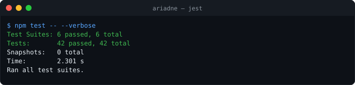
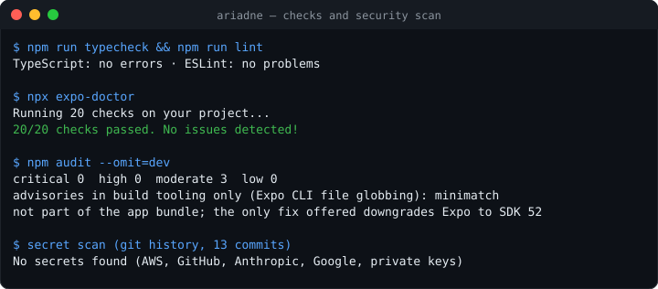

# Ariadne

[](https://github.com/fas0ftware/ariadne/actions/workflows/ci.yml)


A personal self-development tracker for Android. Ariadne asks you every hour what you are doing,
gives every activity a score, and shows your day as a number you can steer.

## Why "Ariadne"

In the Greek myth, Ariadne gave Theseus a ball of thread so he could find his way through the
labyrinth and back out. A day can feel like a labyrinth too: hours disappear and it is hard to
say where they went. Each check-in is a small piece of thread. At the end of the day you can look
back and see the path you actually took, and build a better routine from there.

## Features

### Implemented (version 1)

- **Hourly check-ins.** A notification asks "What are you doing right now?" during your waking
  hours (default 08:00–23:00).
  - Up to 3 quick-action buttons log your most used activities without opening the app.
  - Tapping the notification opens a fast log screen.
  - Settings for waking hours, interval (30/60/90/120 min), snooze and pause.
  - An unanswered check-in shows as "Not logged" and is never penalized.
- **Activities and scoring.**
  - Editable categories (Software, Health, Economy, Learning, Lifestyle, plus your own).
  - Activities with editable point values.
  - Food tracking is just good/bad activities you define. No calories.
- **Daily penalty cap.** Minus points per day stop at a limit (default −20).
- **Streaks.** Consecutive days at or above a daily target score.
- **Today screen.** Today's score, streak, a supportive message, the breakdown by category, one
  big "Log activity" button and a timeline of the day. Long-press a log to remove it.
- **History.** Totals for this week and this month, and every logged day with its score. Tap a
  day to see what you logged.
- **Black and white design.** Light and dark mode follow the system, with a manual toggle.
  Uses the Poppins font.
- **Local-first.** All data lives in SQLite on the phone.

### New in version 1.1

- **Backup and restore.** *Settings → Backup → Share backup* turns everything (categories,
  activities, logs, scoring settings) into one JSON text and opens the system share sheet: save it
  to Files or Drive, or send it to yourself. *Restore from backup* takes that text back.
  - The backup is validated completely before anything changes (types, ranges, dates, references
    between logs, activities and categories, duplicates, size), then restored in a single database
    transaction, so a bad file can never leave half-restored data.
  - Phone-specific state (snooze, scheduled notifications) is not part of a backup.
  - No new permissions and no extra native modules: it works in Expo Go too.
- **CSV export** of every log (date, time, category, activity, points, source) for spreadsheets,
  protected against spreadsheet formula injection.
- **Insights on the History screen.**
  - A black-and-white bar chart of the last 7 days with the target line (filled bars reached it).
  - Best day, longest streak ever, average score per logged day.
  - Where your plus points came from in the last 30 days, per category.

### Planned

- Milestones (Category → Project → Sub-milestone, assigned to days) with bonus points
- Morning plan: up to 3 priorities per day
- Rewards you define, unlocked by points or weekly score
- Evening summary notification
- Calendar, monthly charts
- Backup to a file picker (Storage Access Framework) and automatic backup reminders
- Sync with a computer, widgets, focus timer


## Tech stack

- [Expo](https://expo.dev) SDK 58, React Native, TypeScript
- [Expo Router](https://docs.expo.dev/router/introduction/) for screens
- [expo-sqlite](https://docs.expo.dev/versions/latest/sdk/sqlite/) for local storage
- [expo-notifications](https://docs.expo.dev/versions/latest/sdk/notifications/) and
  expo-task-manager for check-ins and quick actions
- Poppins via `@expo-google-fonts/poppins`

## Project structure

```
index.ts                     Entry point: registers the background task, then starts the router
src/
  app/                       Screens (every file is a route)
    _layout.tsx              Loads fonts, database and settings; theme; navigation stack
    index.tsx                Today screen (home)
    log.tsx                  Fast log screen
    history.tsx              Day-by-day history with week/month totals
    settings.tsx             Theme, check-ins, scoring settings
    activities.tsx           Edit categories and activities
    import.tsx               Restore from a pasted backup
  components/
    ui.tsx                   Text, buttons, rows, steppers, switches
    EditDialog.tsx           Dialog to create or edit a category or activity
    WeekChart.tsx            Last-7-days bar chart (plain Views)
  db/
    schema.ts                Tables, migrations and default data
    database.ts              Shared connection and change events
    queries.ts               Read/write functions for categories, activities, logs
    settings.ts              Settings with defaults (key/value table)
    backup.ts                Read everything for a backup, restore in one transaction
  lib/
    scoring.ts               Day score, penalty cap, streaks, messages
    stats.ts                 Last days, best day, longest streak, category shares
    backup.ts                Backup format, validation, CSV export
    slots.ts                 Check-in slot times
    dates.ts                 Local date helpers and formatting
    SettingsContext.tsx      Settings shared across screens
    useLoader.ts             Reload screen data on focus and on changes
  notifications/
    checkins.ts              Channel, permission, scheduling, quick actions
    NotificationBridge.tsx   Handles notification taps while the app runs
    backgroundTask.ts        Handles quick actions while the app is closed
  theme/theme.ts             Black and white colors, fonts, light/dark
  lib/__tests__/             Unit tests: scoring, slots, dates, stats, backup validation, CSV
  db/__tests__/              Restore order and transaction against a fake database
```

### Database

| Table | Columns |
| --- | --- |
| `categories` | id, name, sort_order, archived |
| `activities` | id, category_id, name, points, is_quick, sort_order, archived |
| `logs` | id, activity_id, points, day, logged_at, slot_start, source, notification_id, note |
| `settings` | key, value (JSON) |

- **Points are copied.** A log stores the activity's points at the moment you log it. Editing an
  activity later does not change your past scores.
- **Removing archives.** Removing a category or activity hides it but keeps your history.
- **Migrations.** The schema version lives in `PRAGMA user_version`. See `src/db/schema.ts`.

## Run it on your Android phone (Expo Go)

1. Install **Expo Go** from the Play Store.
2. On your computer, install [Node.js](https://nodejs.org) (LTS), then:
   ```bash
   npm install
   npx expo start
   ```
3. Make sure the phone and computer are on the same Wi-Fi. Scan the QR code with Expo Go.
   If the network blocks it, use `npx expo start --tunnel`.

Expo Go is the quickest way to try the app. Check-ins, the log screen and buttons tapped while
the app is open all work there. Quick actions tapped while the app is fully closed need a
background task. That is reliable in an installed APK and may not work in Expo Go.

## Build an APK

Build it in the cloud with EAS (free account at expo.dev):

```bash
npx eas-cli@latest login
npx eas-cli@latest build -p android --profile preview
```

When the build finishes, open the link on your phone and install the APK. You may need to allow
"Install unknown apps" for your browser.

To build locally instead, you need Android Studio and its SDK:

```bash
npx expo run:android --variant release
```

## Development checks

Run these before every commit:

```bash
npm run typecheck   # TypeScript
npm run lint        # ESLint (Expo config)
npm test            # Jest unit tests
npx expo-doctor     # dependency and config health
```

42 tests cover scoring, check-in slots, dates, statistics, backup validation (including
hostile input such as SQL in a date field, out-of-range points and broken references), CSV
quoting and formula neutralising, and the restore order inside one transaction.



### Checks and security scan

CI runs the type check, ESLint (no warnings allowed), the tests, `expo-doctor` and `npm audit`.



`npm audit` currently reports moderate advisories in `minimatch`/`glob`, used by Expo's command
line tools to match files at build time. They are not part of the app that runs on the phone,
and the only fix npm offers is a downgrade to Expo SDK 52, so they are tracked until Expo ships
an update.

## How scoring works

**Default activities**

| Category | Activity | Points |
| --- | --- | --- |
| Software | Coding (quick) | +10 |
| Health | Workout (quick) | +10 |
| Health | Ate well | +5 |
| Health | Ate badly | −5 |
| Economy | Tracked spending | +5 |
| Learning | Reading (quick) | +8 |
| Learning | Studying | +8 |
| Lifestyle | Wasted time | −5 |
| Lifestyle | Skipped planned task | −5 |

You can change all of them under **Settings → Edit categories and activities**.

**Day score** = all plus points + minus points, where the minus points are capped at the
**penalty cap** (default −20).

> Example: +30 and −35 in one day gives 30 + (−20) = **10**.

The cap is applied when the score is shown. Changing it updates past days too.

**Unlogged hours** count as 0. You are never penalized for not answering.

**Streak** is the number of consecutive days with a score at or above the **daily target**
(default 20).

- Today joins the streak as soon as you reach the target.
- Until then, an unfinished today does not break it.
- A day without any logs ends the streak.

**Week** runs Monday to Sunday. Week and month totals are the sum of the day scores.

**Tone.** Messages stay supportive. A day below zero shows "Not every day goes to plan.
Tomorrow is a fresh start."

## Notifications on Android

**Permission (Android 13+).** Ariadne asks for notification permission on first launch.

- If you said no, go to **Settings → Allow notifications** in the app.
- Or use Android **Settings → Apps → Ariadne → Notifications**.
- **Settings → Send a test check-in** sends one in 5 seconds, so you can test the buttons with
  the phone locked.

**How check-ins are scheduled.** Ariadne schedules one-time notifications for the next few days
(up to 7 days and at most 300 notifications).

- It refreshes the schedule when you open the app, change a setting, or use a quick action.
- If you don't touch the app or a notification for a week, the check-ins stop. Open the app to
  restart them.

**Battery optimization.** Android may delay or drop reminders to save battery. Phones from
Samsung, Xiaomi, Huawei, OnePlus and Oppo do this the most. To keep check-ins on time:

1. **Settings → Apps → Ariadne → Battery** → choose **Unrestricted** (or "Don't optimize").
2. **Samsung:** Settings → Battery → Background usage limits → remove Ariadne from "Sleeping
   apps", or add it to "Never sleeping apps".
3. **Xiaomi / MIUI / HyperOS:** turn on **Autostart** for Ariadne and set battery saver to
   **No restrictions**.
4. Don't swipe Ariadne away in the recent apps list on phones that treat that as "force stop".

If you use Expo Go, apply these settings to Expo Go instead.

[dontkillmyapp.com](https://dontkillmyapp.com) has instructions for each brand.

Check-ins use inexact alarms, so in deep sleep (Doze) a check-in can arrive a few minutes late.

**Expo Go notes.**

- Expo Go logs a warning that push notifications are unavailable. Ariadne only uses local
  notifications, so you can ignore it.
- On some phones Expo Go rejects creating the "Hourly check-ins" channel. Ariadne then falls
  back to the default notification channel and keeps working.
- The installed APK does not have these limits.

## Roadmap

- **Phase 1 – done:** project setup, SQLite schema, categories and activities with scoring,
  hourly notification with quick actions, log screen, Today screen, history list, light/dark
  theme, settings
- **Phase 2:** milestones (Category → Project → Sub-milestone, monthly/weekly/daily views,
  bonus points) and the morning plan
- **Phase 3:** rewards, evening summary, more charts (export/import and first stats: done in 1.1)
- **Phase 4:** sync with a computer, widgets, focus timer

## Changelog

- **1.1.0** – Backup and restore (validated JSON, one transaction), CSV export, History insights
  (7-day chart, best day, longest streak, average, category shares), Expo SDK 58 patch updates,
  CI with lint, expo-doctor and npm audit.
- **1.0.0** – Hourly check-ins with quick actions, scoring with penalty cap, streaks, Today and
  History screens, light/dark theme.

## Privacy

All data stays on your phone. Ariadne has no account, no server, no analytics and no tracking.
Nothing is sent anywhere. Uninstalling the app deletes your data, so use **Settings → Backup**
regularly. A backup goes only where you send it with the system share sheet.

## License

To be decided. See [LICENSE](LICENSE).
